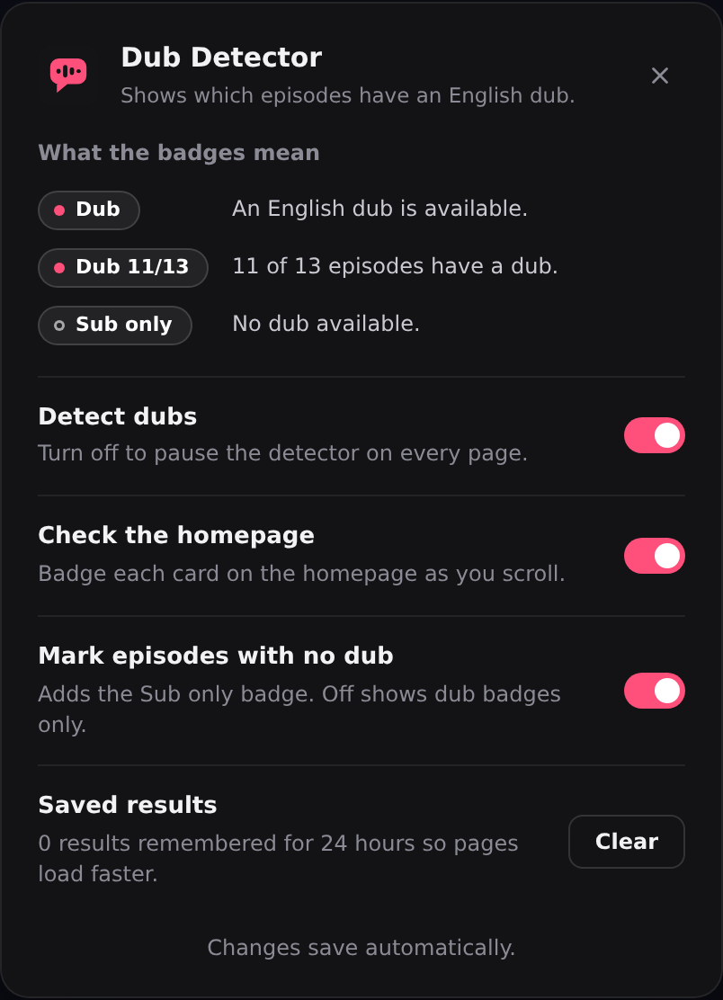

# animepahe DUB Detector Plus

Puts a quiet Dub or Sub only badge on every episode so you don't have to click in and check.

Version 2.5.0 Free, open source, GPL-3.0 (see [LICENSE](LICENSE)).

## What it does

Adds a Dub badge (with a pink dot) to episodes that have an English dub, and a muted Sub only badge to the ones that don't. Works on the homepage, the episode list, and the video player, all automatically, no clicking required. Once it's checked an episode it remembers the result, so it won't ask again every time you load the page.

## Screenshots

## How to install

1. Get a userscript manager. ScriptCat and Violentmonkey are both free, open source, and work in Chrome, Firefox, and Edge.
2. Open the script's [Greasyfork page](https://greasyfork.org/en/scripts/585305-animepahe-dub-detector-plus).
3. Click "Install this script" and confirm in your userscript manager's install screen.
4. Load animepahe.pw or animepahe.org. The badges just show up.

## Settings

Click the small sliders button in the bottom-right corner of any animepahe page. (You can also open it from your userscript manager's menu with "Open Dub Detector settings".) The panel explains what each badge means, and has these options:

- **Detect dubs**: turn the whole detector on or off
- **Check the homepage**: badge homepage cards as you scroll (on by default)
- **Mark episodes with no dub**: show the Sub only badge (dimmed while the detector is off, since there's nothing to show)
- **Saved results**: clear the remembered results to re-check everything

Changes save automatically. When you change something, a Reload page button appears so you can apply it.

## How it works

It only looks at animepahe's own pages to figure out what's dubbed. Nothing gets sent anywhere else, and there's no account or sign-in involved.

## License

GNU GPL-3.0 You're free to use and modify this however you like, just keep any version you share under the same license. Full text in [LICENSE](LICENSE).
